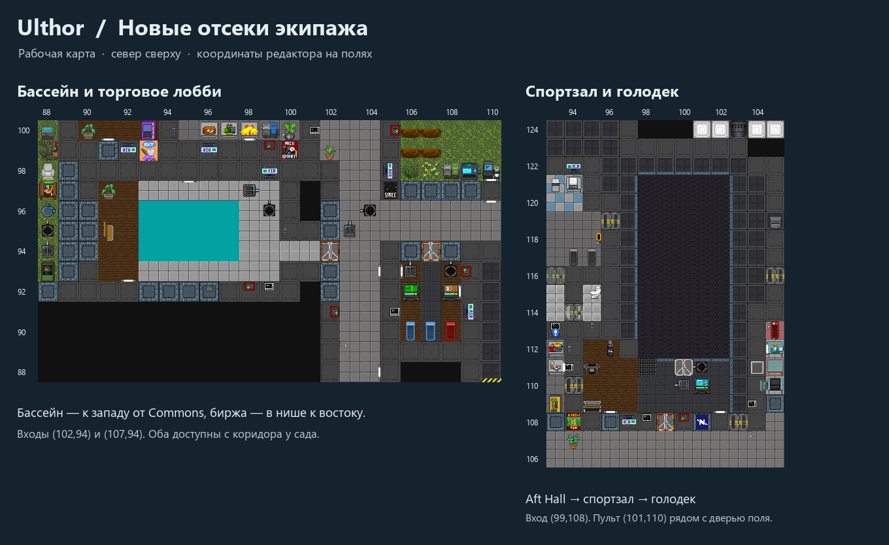
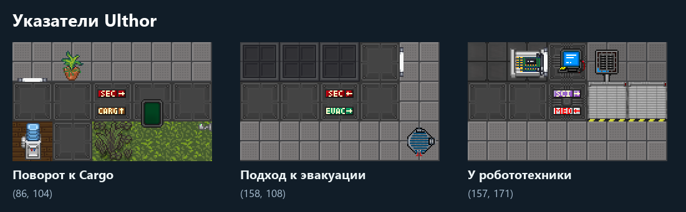

# Ulthor · торговое лобби, бассейн, спортзал и голодек

Четыре помещения построены на игровой карте. Координаты ниже указаны для z=1 в редакторе. На статическом рендере голодек показан до выбора программы.

| Куда идти | Вход | Что видит экипаж |
|---|---|---|
| В торговое лобби | Из Commons к югу через (107,94) | Две консоли стоят друг напротив друга, центральный проход ведёт к трём аварийным шкафам. |
| В бассейн | Из Commons на запад через (102,94) | Чаша 5 × 3 с сухим обходом. Западная площадка с лавкой выходит окнами к библиотеке. |
| В спортзал | Из Aft Hall на север через (99,108) | Слева от входа деревянный настил с жимовой скамьёй и грушей. Справа расположен пульт голодека. |
| В голодек | Из зала на север через (100,111) | За дверью проекционное поле 5 × 10 на (98–102,112–121). Пульт (101,110) и тренажёры находятся вне поля. |

В лобби биржевая консоль стоит на (106,92), торговая — на (108,92). Сотрудник с личным счётом может прийти с ID и купить акции или оформить заказ у торговца. Для ведомственного платежа действуют права соответствующего отдела. Физические заказы, как прежде, прибывают к фрахтовому люку Cargo (73,116), откуда их выдаёт снабжение. На мостике сохраняются оба командных терминала. [Биржа](../code/modules/economy/stock_market/stock_console.dm) · [Торговля](../code/modules/economy/trade/trade_console.dm) · [Доставка](../code/modules/economy/trade/freighter.dm)

У бассейна слева дерево, справа светлая плитка. Чаша занимает (93–97,94–96), контроллер её температуры расположен на южном борту (96,93). Бассейн и биржа получили отдельные АПЦ, свет, сигнализацию, подачу и отвод воздуха. [Бассейн](../code/game/machinery/poolcontroller.dm)

В спортзале жимовая скамья стоит на (95,111), груша — на (96,112). Со стороны Aft Hall через окна видно, занят ли зал. Голодек использует общие сценарии станции. Северный и боковые проходы вокруг поля оставлены техникам. Из Aft Hall они входят через прежний служебный шлюз, перенесённый на (103,108). От него можно дойти до подхода к бригу, технического входа у раздевалки и северной части тоннеля. Питание и линии вентиляции заведены в зал, поле сообщается с ним через решётку. [Снаряды](../code/modules/ruins/objects_and_mobs/gym.dm) · [Голодек](../code/game/machinery/computer/HolodeckControl.dm)

## Проверка в раунде

В изолированном раунде Ulthor прошли 25 серверных проверок. Четыре гражданские двери доступны посетителю, служебная на (103,108) требует доступ. Четыре АПЦ подключились к электросети, шесть атмосферных приборов — к трубам. Обе торговые консоли получили питание, торговый фрахтовик зарегистрировался. Контроллер бассейна нашёл 15 клеток воды и отследил вход и выход персонажа. На голодеке загрузилась баскетбольная площадка, затем контроллер переключил её на пустой корт. Ручную покупку с ID и отрисовку в клиенте эта проверка не охватывала.

## Настенные указатели

| Стена | Откуда читать | Куда ведут стрелки |
|---|---|---|
| (86,104) | Aft Hall, перед поворотом в Port Hall | SEC → к окну Security Reception (127,110). CARGO ↑ через Central Access к Cargo Bay Desk (82,130). |
| (158,108) | Aft Hall, у развилки перед Departures | SEC ← к той же приёмной. EVAC → в зал вылета, в обход поста СБ, к Escape Airlock (179,107). |
| (157,171) | Fore Hall, у робототехники | SCI → к двери Research Division Access (166,171). MED ← к Medbay Entrance (133,178). |

Проверены свободные настенные места, кадры направлений и подходы по карте до каждой двери или стойки. Для посадки действует состояние эвакуационного шлюза, а для прохода внутрь R&D и медбея — штатный доступ дверей. Картинки сняты статическим рендерером со смещениями DMI. Игровое освещение и движение персонажа требуют проверки в раунде.
